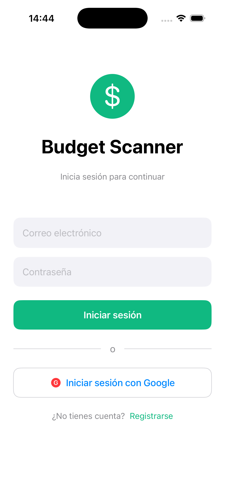
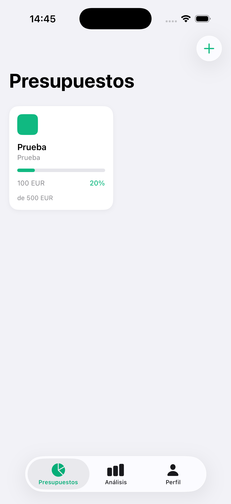
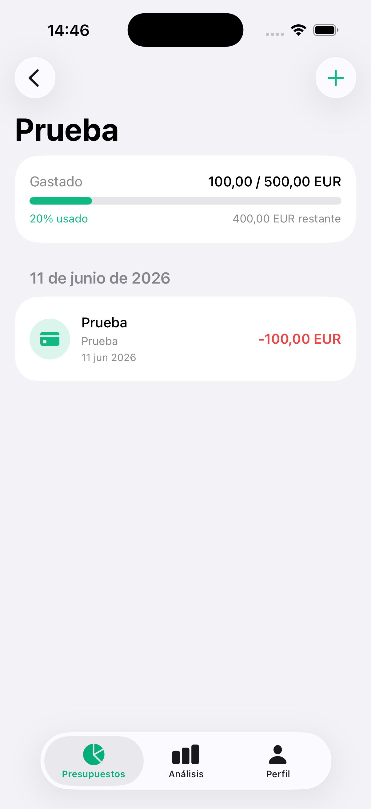
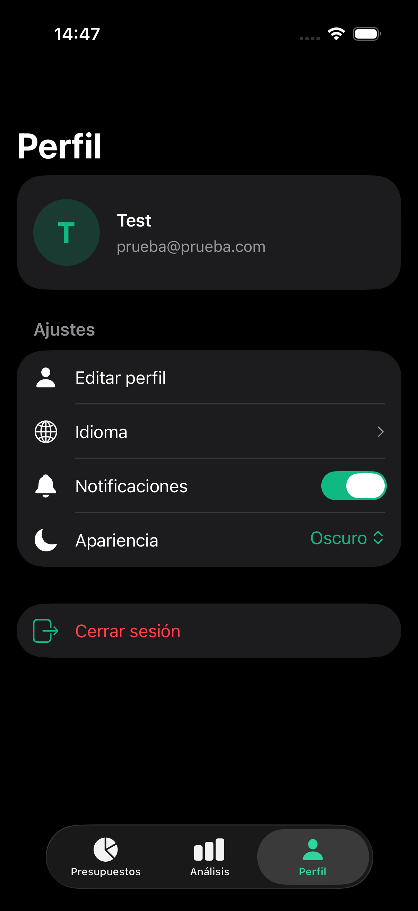
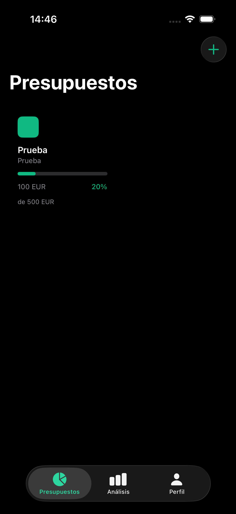
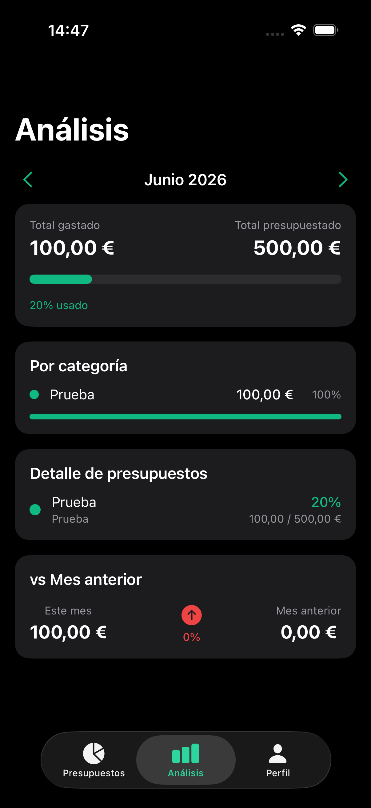

# Budget Scanner

A budget and expense tracking app built as part of the CastroDev portfolio. Create custom budgets, track your spending and get monthly analytics, with full dark mode support.

---

## 📱 Screenshots

<p align="center">
  
  
  
  
</p>
<p align="center">
  
  
</p>

---

## ✨ Features

- 💰 **Budgets** — Create budgets with custom colours, categories, limits and alert thresholds
- 📋 **Transactions** — Log expenses with categories, tags, notes and merchant info
- 📊 **Analytics** — Monthly summary, category breakdown and month-over-month comparison
- 🔔 **Alert threshold** — Each budget flags when spending reaches the configured percentage
- 🔁 **Recurring budgets** — Reset recurring budgets for the new month
- 🌙 **Dark mode** — Automatic dark/light mode based on system settings
- 👤 **Profile** — Edit your name and notification and language preferences
- 🌍 **Multilingual** — English and Spanish support

---

## 🛠️ Tech Stack

| Layer | Technology |
|---|---|
| Language | Swift (Swift 5 language mode) |
| UI Framework | SwiftUI |
| State Management | `@Observable` + `@State` |
| Authentication | Firebase Auth (Email + Google) |
| Backend | .NET 10 REST API (Clean Architecture) |
| Database | Cloud Firestore (behind the API) |
| Logging | swift-log |
| Tests | Swift Testing |
| Infrastructure | Google Cloud Run |
| Dependency Management | Swift Package Manager |

---

## 🏗️ Architecture

The app follows **Clean Architecture** principles with strict layer separation:

```
BudgetScanner/
├── Core/
│   ├── Config/          # API endpoints, colours, theme
│   ├── Errors/          # Failure types
│   ├── Logging/         # AppLogger (swift-log)
│   └── Network/         # API client with Firebase auth
└── Features/
    ├── Auth/            # Login, register, Google Sign-In
    ├── Budgets/         # CRUD budgets, alerts, recurring
    ├── Transactions/    # CRUD transactions
    ├── Analytics/       # Monthly summary, categories, comparison
    └── Profile/         # Name, language and notification preferences
```

Each feature follows the pattern:

```
Feature/
├── Data/
│   ├── DataSources/     # Remote API calls
│   ├── Models/          # DTO models
│   └── Repositories/    # Repository implementations
├── Domain/
│   ├── Entities/        # Domain entities
│   ├── Repositories/    # Abstract repository interfaces
│   └── UseCases/        # Business logic use cases
└── Presentation/
    ├── Views/           # SwiftUI screens
    ├── ViewModels/      # @Observable ViewModels
    └── Components/      # Reusable UI components
```

---

## 🧭 Technical Decisions

- **Clean Architecture per feature.** Each feature has its own `Data / Domain / Presentation`. The domain layer only imports Foundation, so business rules can be tested without a device or Firebase.
- **`@Observable` ViewModels with an enum for each screen state.** `loading`, `loaded` and `error` are explicit cases, so a view cannot read data that is not there. No `ObservableObject` and no Combine.
- **`async/await` with typed errors.** Repositories and data sources `throw` a `Failure`; the ViewModels catch it, log it through `AppLogger` (swift-log) and turn it into screen state. Technical detail goes to the log, not to the user.
- **Validation in the use cases.** Input rules (empty name, amount or limit not above zero) live in the domain as `Failure.validation`, so they are tested once and never reach the network.
- **One use case per operation.** Every feature goes through use cases, so the rule is uniform. The trade-off is some thin classes that only forward the call.
- **Dependencies behind protocols, wired with default arguments.** Production code builds the real implementations through the ViewModel initialisers, and tests inject fakes. There is no DI container, which keeps the project small; the cost is that wiring lives in the initialisers.
- **Profile edits report success.** `ProfileViewModel.update` returns whether the save worked. The edit sheet only closes on success and shows an alert otherwise, and the loaded profile is kept, so a failed save never loses what the user was looking at.
- **A network client that can be tested.** `NetworkClient` receives its `URLSession` and a token provider, so the tests run it against a stubbed `URLProtocol` and check the bearer header, status mapping and decoding without touching the network.
- **Shared .NET 10 API.** Business rules live on the server; the app sends the Firebase ID token. One backend serves all the apps in this portfolio.
- **Tests with Swift Testing and hand-written fakes.** ViewModels, repository mappings and the network client are covered with fakes of the domain protocols, with no mocking library.

### Other projects in this portfolio

| Project | Platform | Language |
|---|---|---|
| [finance-tracker](https://github.com/gcalvarez93/finance-tracker) | Flutter (iOS + Android) | Dart |
| [habit-tracker](https://github.com/gcalvarez93/habit-tracker) | Flutter (iOS + Android) | Dart |
| [task-manager](https://github.com/gcalvarez93/task-manager) | iOS | Swift |
| [budget-scanner](https://github.com/gcalvarez93/budget-scanner) | iOS | Swift |
| [recipe-manager](https://github.com/gcalvarez93/recipe-manager) | Android | Kotlin |
| [workout-tracker](https://github.com/gcalvarez93/workout-tracker) | Android | Kotlin |
| [castrodev-api](https://github.com/gcalvarez93/castrodev-api) | Shared backend | C# (.NET 10) |

---

## 🚀 Getting Started

### Prerequisites

- Xcode 26+
- iOS 26.5 deployment target (simulator or device)
- A Firebase project with Email and Google sign-in enabled
- The API at `api.castrodev.com` (the base URL is set in `Core/Config/APIConfig.swift`) or your own instance

### Installation

```bash
# Clone the repository
git clone https://github.com/gcalvarez93/budget-scanner.git

# Open in Xcode
open budget-scanner/BudgetScanner/BudgetScanner.xcodeproj
```

Then:

1. Add your own `GoogleService-Info.plist` to the main target in Xcode
2. Swift Package Manager dependencies resolve automatically on first open
3. Build and run with `⌘R`

### Running Tests

```bash
cd BudgetScanner
xcodebuild test \
  -scheme BudgetScanner \
  -destination 'platform=iOS Simulator,name=iPhone 17'
```

---

## 🔗 Related

- [CastroDev API](https://github.com/gcalvarez93/castrodev-api) — Shared .NET 10 backend
- [Finance Tracker](https://github.com/gcalvarez93/finance-tracker) — Personal finance app (Flutter)
- [Habit Tracker](https://github.com/gcalvarez93/habit-tracker) — Daily habit tracking app (Flutter)
- [Task Manager](https://github.com/gcalvarez93/task-manager) — Board-based task management (iOS)

---

## 📄 License

MIT © Gabriel Castro

---

---

# Budget Scanner

App de seguimiento de presupuestos y gastos desarrollada como parte del portfolio de CastroDev. Crea presupuestos personalizados, registra tus gastos y obtén análisis mensuales, con soporte completo de modo oscuro.

---

## ✨ Funcionalidades

- 💰 **Presupuestos** — Crea presupuestos con colores, categorías, límites y umbrales de alerta personalizados
- 📋 **Transacciones** — Registra gastos con categorías, etiquetas, notas e información del comercio
- 📊 **Análisis** — Resumen mensual, desglose por categoría y comparativa mes a mes
- 🔔 **Umbral de alerta** — Cada presupuesto avisa cuando el gasto alcanza el porcentaje configurado
- 🔁 **Presupuestos recurrentes** — Reseteo de los presupuestos recurrentes para el nuevo mes
- 🌙 **Modo oscuro** — Modo oscuro/claro automático según el sistema
- 👤 **Perfil** — Edita tu nombre y tus preferencias de notificaciones e idioma
- 🌍 **Multiidioma** — Soporte para español e inglés

---

## 🛠️ Stack Tecnológico

| Capa | Tecnología |
|---|---|
| Lenguaje | Swift (modo de lenguaje Swift 5) |
| UI Framework | SwiftUI |
| Estado | `@Observable` + `@State` |
| Autenticación | Firebase Auth (Email + Google) |
| Backend | API REST .NET 10 (Clean Architecture) |
| Base de datos | Cloud Firestore (detrás de la API) |
| Logging | swift-log |
| Tests | Swift Testing |
| Infraestructura | Google Cloud Run |
| Gestión de dependencias | Swift Package Manager |

---

## 🧭 Decisiones Técnicas

- **Clean Architecture por feature.** Cada feature tiene su propio `Data / Domain / Presentation`. La capa de dominio solo importa Foundation, así que las reglas de negocio se prueban sin dispositivo ni Firebase.
- **ViewModels `@Observable` con un enum por estado de pantalla.** `loading`, `loaded` y `error` son casos explícitos, y la vista no puede leer datos que no existen. Sin `ObservableObject` ni Combine.
- **`async/await` con errores tipados.** Los repositorios y data sources lanzan un `Failure`; los ViewModels lo capturan, lo registran con `AppLogger` (swift-log) y lo convierten en estado de pantalla. El detalle técnico va al log, no al usuario.
- **Validación en los casos de uso.** Las reglas de entrada (nombre vacío, importe o límite no mayor que cero) viven en el dominio como `Failure.validation`, así que se prueban una vez y nunca llegan a la red.
- **Un caso de uso por operación.** Todas las features pasan por casos de uso, así que la regla es uniforme. El inconveniente son algunas clases finas que solo reenvían la llamada.
- **Dependencias tras protocolos, enlazadas con argumentos por defecto.** El código de producción construye las implementaciones reales en los inicializadores de los ViewModels, y los tests inyectan fakes. No hay contenedor de DI, lo que mantiene el proyecto pequeño; el coste es que el enlazado vive en los inicializadores.
- **Las ediciones de perfil informan del resultado.** `ProfileViewModel.update` devuelve si el guardado funcionó. La hoja de edición solo se cierra si tiene éxito y, si no, muestra una alerta; además se conserva el perfil cargado, así que un guardado fallido nunca hace perder lo que el usuario estaba viendo.
- **Un cliente de red que se puede probar.** `NetworkClient` recibe su `URLSession` y un proveedor de token, así que los tests lo ejecutan contra un `URLProtocol` simulado y comprueban la cabecera bearer, el mapeo de códigos HTTP y la decodificación sin tocar la red.
- **API compartida en .NET 10.** Las reglas de negocio viven en el servidor; la app envía el token de Firebase. Un solo backend sirve a todas las apps de este portfolio.
- **Tests con Swift Testing y fakes escritos a mano.** Los ViewModels, los mapeos de repositorios y el cliente de red están cubiertos con fakes de los protocolos del dominio, sin librería de mocks.

### Otros proyectos del portfolio

| Proyecto | Plataforma | Lenguaje |
|---|---|---|
| [finance-tracker](https://github.com/gcalvarez93/finance-tracker) | Flutter (iOS + Android) | Dart |
| [habit-tracker](https://github.com/gcalvarez93/habit-tracker) | Flutter (iOS + Android) | Dart |
| [task-manager](https://github.com/gcalvarez93/task-manager) | iOS | Swift |
| [budget-scanner](https://github.com/gcalvarez93/budget-scanner) | iOS | Swift |
| [recipe-manager](https://github.com/gcalvarez93/recipe-manager) | Android | Kotlin |
| [workout-tracker](https://github.com/gcalvarez93/workout-tracker) | Android | Kotlin |
| [castrodev-api](https://github.com/gcalvarez93/castrodev-api) | Backend compartido | C# (.NET 10) |

---

## 🚀 Instalación

### Requisitos previos

- Xcode 26+
- Objetivo de despliegue iOS 26.5 (simulador o dispositivo)
- Un proyecto Firebase con acceso por email y Google activado
- La API en `api.castrodev.com` (la URL base está en `Core/Config/APIConfig.swift`) o tu propia instancia

### Pasos

```bash
# Clonar el repositorio
git clone https://github.com/gcalvarez93/budget-scanner.git

# Abrir en Xcode
open budget-scanner/BudgetScanner/BudgetScanner.xcodeproj
```

A continuación:

1. Añade tu propio `GoogleService-Info.plist` al target principal en Xcode
2. Las dependencias de Swift Package Manager se resuelven automáticamente al abrir el proyecto
3. Compila y ejecuta con `⌘R`

### Tests

```bash
cd BudgetScanner
xcodebuild test \
  -scheme BudgetScanner \
  -destination 'platform=iOS Simulator,name=iPhone 17'
```

---

## 🔗 Relacionado

- [CastroDev API](https://github.com/gcalvarez93/castrodev-api) — Backend compartido en .NET 10
- [Finance Tracker](https://github.com/gcalvarez93/finance-tracker) — App de finanzas personales (Flutter)
- [Habit Tracker](https://github.com/gcalvarez93/habit-tracker) — App de seguimiento de hábitos (Flutter)
- [Task Manager](https://github.com/gcalvarez93/task-manager) — Gestión de tareas por tableros (iOS)

---

## 📄 Licencia

MIT © Gabriel Castro
