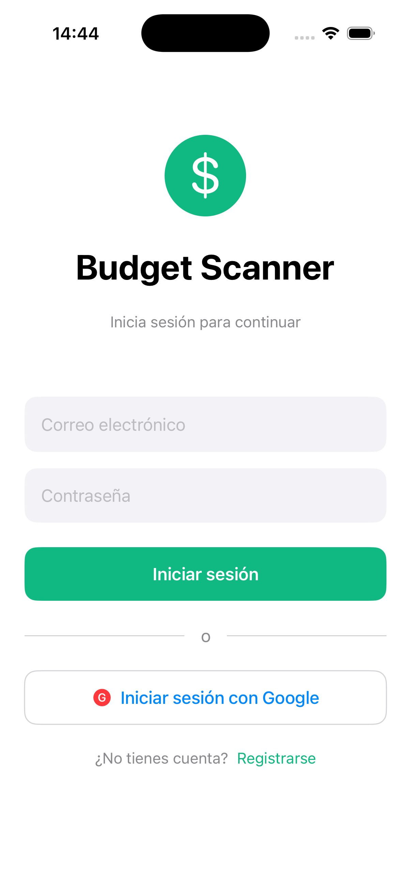
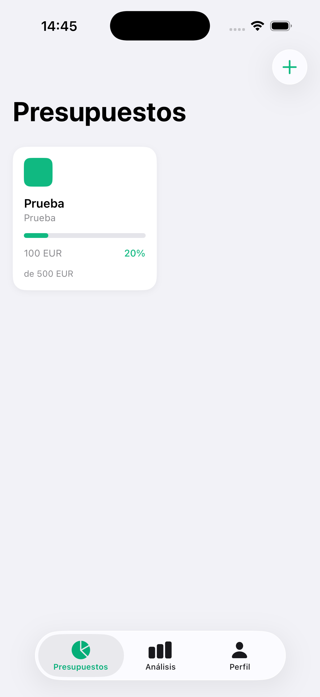
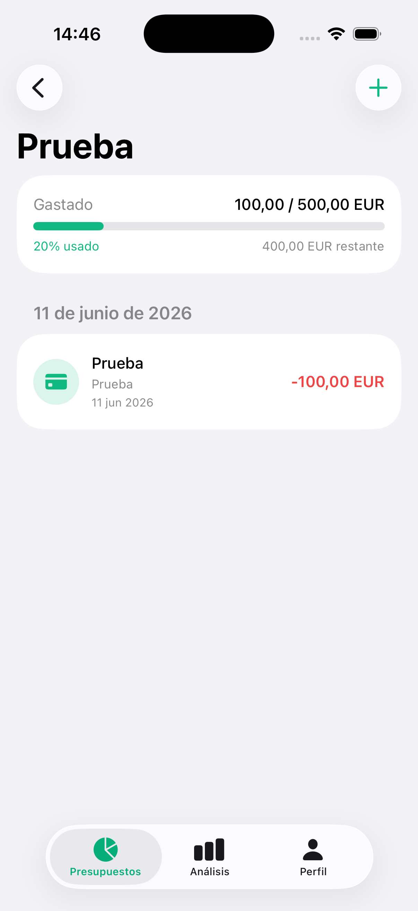
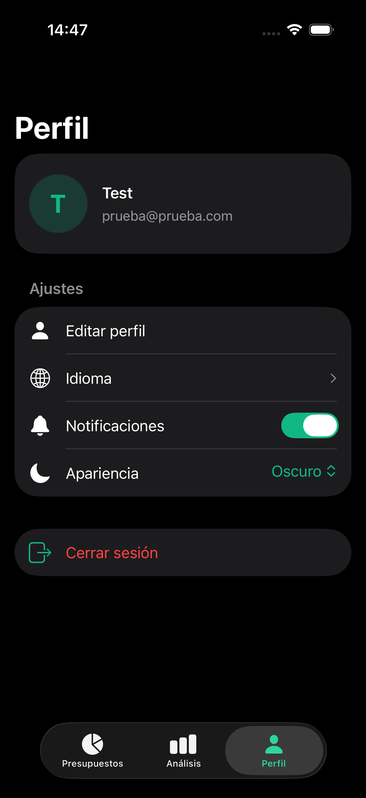
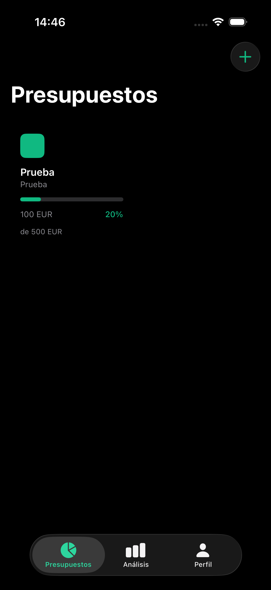
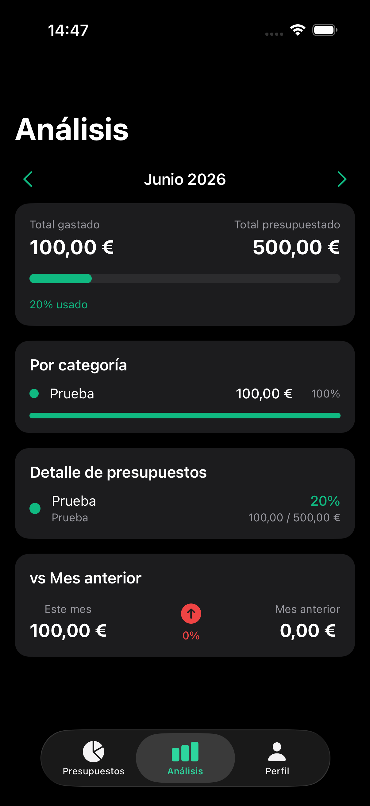

# Budget Scanner

A budget and expense tracking app built as part of the CastroDev portfolio. Create custom budgets, track your spending and get monthly analytics, with full dark mode support.

---

## 📱 Screenshots

<p align="center">
  
  
  
  
</p>
<p align="center">
  
  
</p>

---

## ✨ Features

- 💰 **Budgets** — Create budgets with custom colours, categories, limits and alert thresholds
- 📋 **Transactions** — Log expenses with categories, tags, notes and merchant info
- 📊 **Analytics** — Monthly summary, category breakdown and month-over-month comparison
- 🔔 **Alert threshold** — Each budget flags when spending reaches the configured percentage
- 🔁 **Recurring budgets** — Reset recurring budgets for the new month
- 🌙 **Dark mode** — Automatic dark/light mode based on system settings
- 👤 **Profile** — Edit your name and notification and language preferences
- 🌍 **Multilingual** — English and Spanish support

---

## 🛠️ Tech Stack

| Layer | Technology |
|---|---|
| Language | Swift (Swift 5 language mode) |
| UI Framework | SwiftUI |
| State Management | `@Observable` + `@State` |
| Authentication | Firebase Auth (Email + Google) |
| Backend | .NET 10 REST API (Clean Architecture) |
| Database | Cloud Firestore (behind the API) |
| Logging | swift-log |
| Tests | Swift Testing |
| Infrastructure | Google Cloud Run |
| Dependency Management | Swift Package Manager |

---

## 🏗️ Architecture

The app follows **Clean Architecture** principles with strict layer separation:

```
BudgetScanner/
├── Core/
│   ├── Config/          # API endpoints, colours, theme
│   ├── Errors/          # Failure types
│   ├── Logging/         # AppLogger (swift-log)
│   └── Network/         # API client with Firebase auth
└── Features/
    ├── Auth/            # Login, register, Google Sign-In
    ├── Budgets/         # CRUD budgets, alerts, recurring
    ├── Transactions/    # CRUD transactions
    ├── Analytics/       # Monthly summary, categories, comparison
    └── Profile/         # Name, language and notification preferences
```

Each feature follows the pattern:

```
Feature/
├── Data/
│   ├── DataSources/     # Remote API calls
│   ├── Models/          # DTO models
│   └── Repositories/    # Repository implementations
├── Domain/
│   ├── Entities/        # Domain entities
│   ├── Repositories/    # Abstract repository interfaces
│   └── UseCases/        # Business logic use cases
└── Presentation/
    ├── Views/           # SwiftUI screens
    ├── ViewModels/      # @Observable ViewModels
    └── Components/      # Reusable UI components
```

---

## 🧭 Technical Decisions

- **Clean Architecture per feature.** Each feature has its own `Data / Domain / Presentation`. The domain layer only imports Foundation, so business rules can be tested without a device or Firebase.
- **`@Observable` ViewModels with an enum for each screen state.** `loading`, `loaded` and `error` are explicit cases, so a view cannot read data that is not there. No `ObservableObject` and no Combine.
- **`async/await` with typed errors.** Repositories and data sources `throw` a `Failure`; the ViewModels catch it, log it through `AppLogger` (swift-log) and turn it into screen state. Each `Failure` has a technical description for the log and a separate localised `userMessage` (English and Spanish) for the screen, so technical detail goes to the log, not to the user. Any error that is not a `Failure` falls back to a generic message.
- **Validation in the use cases.** Input rules (empty name, amount or limit not above zero) live in the domain as `Failure.validation` with a localised message, so they are tested once and never reach the network.
- **One use case per operation.** Every feature goes through use cases, so the rule is uniform. The trade-off is some thin classes that only forward the call.
- **Dependencies behind protocols, wired with default arguments.** Production code builds the real implementations through the ViewModel initialisers, and tests inject fakes. There is no DI container, which keeps the project small; the cost is that wiring lives in the initialisers.
- **Failed writes never lose what the user has.** Creating, editing and deleting budgets and transactions return the user message on failure (`nil` on success). The add and edit sheets only close on success and show an alert otherwise, keeping what was typed; a failed delete shows an alert and keeps the loaded list. `ProfileViewModel.update` works the same way, and a failed sign-out keeps the session open.
- **Firebase errors are translated, not shown.** `FirebaseAuthErrorMapper` is a pure function that turns Firebase Auth error codes into `Failure` cases (wrong credentials, email already in use, weak password, too many requests, no network). During sign-in the login screen stays on screen with its fields, so a wrong password shows an alert instead of clearing the form.
- **Cancellation is not an error.** Cancelling a request or closing the Google sign-in window restores the previous state instead of showing an error.
- **A network client that can be tested.** `NetworkClient` receives its `URLSession` and a token provider, so the tests run it against a stubbed `URLProtocol` and check the bearer header, status mapping and decoding without touching the network.
- **Shared .NET 10 API.** Business rules live on the server; the app sends the Firebase ID token. One backend serves all the apps in this portfolio.
- **Tests with Swift Testing and hand-written fakes.** ViewModels, repository mappings, the network client, the Firebase error mapper and the user-facing messages are covered with fakes of the domain protocols, with no mocking library. The alerts and sheets themselves are not covered by automated UI tests.

### Known limitations

Deliberate technical debt, documented rather than hidden:

- **Expired session.** The network client treats every non-2xx response as a generic server error: a 401 is not told apart from a 500, and the app does not sign the user out or retry on its own. Firebase renews the ID token when the app asks for it, so the case is rare, but a server-side 401 ends in an error alert. Timeouts are the `URLSession` defaults rather than explicit values.
- **Receipt scanning is not implemented.** Despite the name, the app does not scan receipts yet. The data model already has room for it (`isScanned`, `receiptImageUrl`), but every transaction is currently entered by hand.
- **Lists are reloaded through the global loading state.** After a successful create, edit or delete the list is reloaded and, while it loads, replaced by a spinner. If that reload fails, the full-screen error replaces the list even though the write succeeded. A failed write on its own does keep the list, as described above.
- **No retry button on load errors.** The full-screen error state only shows the message.
- **Analytics loads as a single unit.** The monthly summary and the month comparison are requested together; if either request fails, the whole screen shows the error and nothing from the other request is kept.
- **Test coverage.** The automated tests cover ViewModels, the budget and transaction repositories, the network client, the Firebase error mapper and the user-facing messages. The auth, analytics and profile repositories have no dedicated tests, and there are no automated UI tests (alerts and sheets are checked by hand).
- **No DI container.** Dependencies are wired with default arguments in each ViewModel initialiser. That is simple at this size; if the project grew, a container would centralise the wiring.
- **Shared code is copied, not shared.** `NetworkClient`, `Failure` and `FirebaseAuthErrorMapper` also exist in task-manager; there is no shared Swift package, so a fix has to be applied in both.

### Other projects in this portfolio

| Project | Platform | Language |
|---|---|---|
| [finance-tracker](https://github.com/gcalvarez93/finance-tracker) | Flutter (iOS + Android) | Dart |
| [habit-tracker](https://github.com/gcalvarez93/habit-tracker) | Flutter (iOS + Android) | Dart |
| [task-manager](https://github.com/gcalvarez93/task-manager) | iOS | Swift |
| [task-manager-kmp](https://github.com/gcalvarez93/task-manager-kmp) | Android + iOS | Kotlin Multiplatform + Swift |
| [budget-scanner](https://github.com/gcalvarez93/budget-scanner) | iOS | Swift |
| [recipe-manager](https://github.com/gcalvarez93/recipe-manager) | Android | Kotlin |
| [workout-tracker](https://github.com/gcalvarez93/workout-tracker) | Android | Kotlin |
| [castrodev-api](https://github.com/gcalvarez93/castrodev-api) | Shared backend | C# (.NET 10) |

---

## 🚀 Getting Started

### Prerequisites

- Xcode 26+
- iOS 26.5 deployment target (simulator or device)
- A Firebase project with Email and Google sign-in enabled
- The API at `api.castrodev.com` (the base URL is set in `Core/Config/APIConfig.swift`) or your own instance

### Installation

```bash
# Clone the repository
git clone https://github.com/gcalvarez93/budget-scanner.git

# Open in Xcode
open budget-scanner/BudgetScanner/BudgetScanner.xcodeproj
```

Then:

1. Add your own `GoogleService-Info.plist` to the main target in Xcode
2. Swift Package Manager dependencies resolve automatically on first open
3. Build and run with `⌘R`

### Running Tests

```bash
cd BudgetScanner
xcodebuild test \
  -scheme BudgetScanner \
  -destination 'platform=iOS Simulator,name=iPhone 17'
```

---

## 🔗 Related

- [CastroDev API](https://github.com/gcalvarez93/castrodev-api) — Shared .NET 10 backend
- [Finance Tracker](https://github.com/gcalvarez93/finance-tracker) — Personal finance app (Flutter)
- [Habit Tracker](https://github.com/gcalvarez93/habit-tracker) — Daily habit tracking app (Flutter)
- [Task Manager](https://github.com/gcalvarez93/task-manager) — Board-based task management (iOS)

---

## 📄 License

MIT © Gabriel Castro

---

---

# Budget Scanner

App de seguimiento de presupuestos y gastos desarrollada como parte del portfolio de CastroDev. Crea presupuestos personalizados, registra tus gastos y obtén análisis mensuales, con soporte completo de modo oscuro.

---

## ✨ Funcionalidades

- 💰 **Presupuestos** — Crea presupuestos con colores, categorías, límites y umbrales de alerta personalizados
- 📋 **Transacciones** — Registra gastos con categorías, etiquetas, notas e información del comercio
- 📊 **Análisis** — Resumen mensual, desglose por categoría y comparativa mes a mes
- 🔔 **Umbral de alerta** — Cada presupuesto avisa cuando el gasto alcanza el porcentaje configurado
- 🔁 **Presupuestos recurrentes** — Reseteo de los presupuestos recurrentes para el nuevo mes
- 🌙 **Modo oscuro** — Modo oscuro/claro automático según el sistema
- 👤 **Perfil** — Edita tu nombre y tus preferencias de notificaciones e idioma
- 🌍 **Multiidioma** — Soporte para español e inglés

---

## 🛠️ Stack Tecnológico

| Capa | Tecnología |
|---|---|
| Lenguaje | Swift (modo de lenguaje Swift 5) |
| UI Framework | SwiftUI |
| Estado | `@Observable` + `@State` |
| Autenticación | Firebase Auth (Email + Google) |
| Backend | API REST .NET 10 (Clean Architecture) |
| Base de datos | Cloud Firestore (detrás de la API) |
| Logging | swift-log |
| Tests | Swift Testing |
| Infraestructura | Google Cloud Run |
| Gestión de dependencias | Swift Package Manager |

---

## 🧭 Decisiones Técnicas

- **Clean Architecture por feature.** Cada feature tiene su propio `Data / Domain / Presentation`. La capa de dominio solo importa Foundation, así que las reglas de negocio se prueban sin dispositivo ni Firebase.
- **ViewModels `@Observable` con un enum por estado de pantalla.** `loading`, `loaded` y `error` son casos explícitos, y la vista no puede leer datos que no existen. Sin `ObservableObject` ni Combine.
- **`async/await` con errores tipados.** Los repositorios y data sources lanzan un `Failure`; los ViewModels lo capturan, lo registran con `AppLogger` (swift-log) y lo convierten en estado de pantalla. Cada `Failure` tiene una descripción técnica para el log y un `userMessage` localizado aparte (español e inglés) para la pantalla, así que el detalle técnico va al log, no al usuario. Cualquier error que no sea un `Failure` usa un mensaje genérico.
- **Validación en los casos de uso.** Las reglas de entrada (nombre vacío, importe o límite no mayor que cero) viven en el dominio como `Failure.validation` con un mensaje localizado, así que se prueban una vez y nunca llegan a la red.
- **Un caso de uso por operación.** Todas las features pasan por casos de uso, así que la regla es uniforme. El inconveniente son algunas clases finas que solo reenvían la llamada.
- **Dependencias tras protocolos, enlazadas con argumentos por defecto.** El código de producción construye las implementaciones reales en los inicializadores de los ViewModels, y los tests inyectan fakes. No hay contenedor de DI, lo que mantiene el proyecto pequeño; el coste es que el enlazado vive en los inicializadores.
- **Una escritura fallida no hace perder lo que el usuario tiene.** Crear, editar y borrar presupuestos y transacciones devuelven el mensaje para el usuario si fallan (`nil` si salen bien). Las hojas de crear y editar solo se cierran si tiene éxito y, si no, muestran una alerta conservando lo escrito; un borrado fallido muestra una alerta y mantiene la lista cargada. `ProfileViewModel.update` funciona igual, y un cierre de sesión fallido mantiene la sesión abierta.
- **Los errores de Firebase se traducen, no se muestran.** `FirebaseAuthErrorMapper` es una función pura que convierte los códigos de error de Firebase Auth en casos de `Failure` (credenciales incorrectas, email ya en uso, contraseña débil, demasiados intentos, sin red). Durante el inicio de sesión la pantalla de login sigue visible con sus campos, así que una contraseña incorrecta muestra una alerta en lugar de vaciar el formulario.
- **Cancelar no es un error.** Cancelar una petición o cerrar la ventana de Google restaura el estado anterior en lugar de mostrar un error.
- **Un cliente de red que se puede probar.** `NetworkClient` recibe su `URLSession` y un proveedor de token, así que los tests lo ejecutan contra un `URLProtocol` simulado y comprueban la cabecera bearer, el mapeo de códigos HTTP y la decodificación sin tocar la red.
- **API compartida en .NET 10.** Las reglas de negocio viven en el servidor; la app envía el token de Firebase. Un solo backend sirve a todas las apps de este portfolio.
- **Tests con Swift Testing y fakes escritos a mano.** Los ViewModels, los mapeos de repositorios, el cliente de red, el traductor de errores de Firebase y los mensajes para el usuario están cubiertos con fakes de los protocolos del dominio, sin librería de mocks. Las alertas y las hojas en sí no tienen tests de UI automáticos.

### Limitaciones conocidas

Deuda técnica asumida a propósito, documentada en lugar de ocultada:

- **Sesión caducada.** El cliente de red trata cualquier respuesta no 2xx como un error genérico de servidor: un 401 no se distingue de un 500, y la app no cierra la sesión ni reintenta por sí sola. Firebase renueva el token de ID cuando la app lo pide, así que el caso es raro, pero un 401 del servidor acaba en una alerta de error. Los timeouts son los de `URLSession` por defecto, no valores explícitos.
- **El escaneo de recibos no está implementado.** Pese al nombre, la app todavía no escanea recibos. El modelo de datos ya tiene sitio para ello (`isScanned`, `receiptImageUrl`), pero ahora todas las transacciones se introducen a mano.
- **Las listas se recargan con el estado de carga global.** Tras crear, editar o borrar con éxito se recarga la lista y, mientras carga, se sustituye por un indicador de carga. Si esa recarga falla, el error a pantalla completa reemplaza la lista aunque la escritura haya salido bien. Una escritura fallida por sí sola sí conserva la lista, como se describe arriba.
- **Sin botón de reintento en los errores de carga.** El estado de error a pantalla completa solo muestra el mensaje.
- **Análisis se carga como una sola unidad.** El resumen mensual y la comparativa con el mes anterior se piden a la vez; si falla cualquiera de las dos peticiones, toda la pantalla muestra el error y no se conserva nada de la otra.
- **Cobertura de tests.** Los tests automáticos cubren ViewModels, los repositorios de presupuestos y de transacciones, el cliente de red, el traductor de errores de Firebase y los mensajes para el usuario. Los repositorios de auth, analytics y perfil no tienen tests propios, y no hay tests de UI automáticos (las alertas y las hojas se comprueban a mano).
- **Sin contenedor de DI.** Las dependencias se enlazan con argumentos por defecto en el inicializador de cada ViewModel. Es sencillo a este tamaño; si el proyecto creciera, un contenedor centralizaría el enlazado.
- **Código compartido copiado, no compartido.** `NetworkClient`, `Failure` y `FirebaseAuthErrorMapper` existen también en task-manager; no hay un paquete Swift común, así que una corrección hay que aplicarla en los dos.

### Otros proyectos del portfolio

| Proyecto | Plataforma | Lenguaje |
|---|---|---|
| [finance-tracker](https://github.com/gcalvarez93/finance-tracker) | Flutter (iOS + Android) | Dart |
| [habit-tracker](https://github.com/gcalvarez93/habit-tracker) | Flutter (iOS + Android) | Dart |
| [task-manager](https://github.com/gcalvarez93/task-manager) | iOS | Swift |
| [task-manager-kmp](https://github.com/gcalvarez93/task-manager-kmp) | Android + iOS | Kotlin Multiplatform + Swift |
| [budget-scanner](https://github.com/gcalvarez93/budget-scanner) | iOS | Swift |
| [recipe-manager](https://github.com/gcalvarez93/recipe-manager) | Android | Kotlin |
| [workout-tracker](https://github.com/gcalvarez93/workout-tracker) | Android | Kotlin |
| [castrodev-api](https://github.com/gcalvarez93/castrodev-api) | Backend compartido | C# (.NET 10) |

---

## 🚀 Instalación

### Requisitos previos

- Xcode 26+
- Objetivo de despliegue iOS 26.5 (simulador o dispositivo)
- Un proyecto Firebase con acceso por email y Google activado
- La API en `api.castrodev.com` (la URL base está en `Core/Config/APIConfig.swift`) o tu propia instancia

### Pasos

```bash
# Clonar el repositorio
git clone https://github.com/gcalvarez93/budget-scanner.git

# Abrir en Xcode
open budget-scanner/BudgetScanner/BudgetScanner.xcodeproj
```

A continuación:

1. Añade tu propio `GoogleService-Info.plist` al target principal en Xcode
2. Las dependencias de Swift Package Manager se resuelven automáticamente al abrir el proyecto
3. Compila y ejecuta con `⌘R`

### Tests

```bash
cd BudgetScanner
xcodebuild test \
  -scheme BudgetScanner \
  -destination 'platform=iOS Simulator,name=iPhone 17'
```

---

## 🔗 Relacionado

- [CastroDev API](https://github.com/gcalvarez93/castrodev-api) — Backend compartido en .NET 10
- [Finance Tracker](https://github.com/gcalvarez93/finance-tracker) — App de finanzas personales (Flutter)
- [Habit Tracker](https://github.com/gcalvarez93/habit-tracker) — App de seguimiento de hábitos (Flutter)
- [Task Manager](https://github.com/gcalvarez93/task-manager) — Gestión de tareas por tableros (iOS)

---

## 📄 Licencia

MIT © Gabriel Castro
